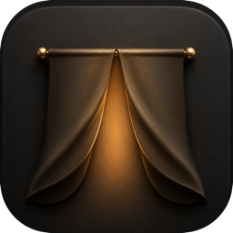
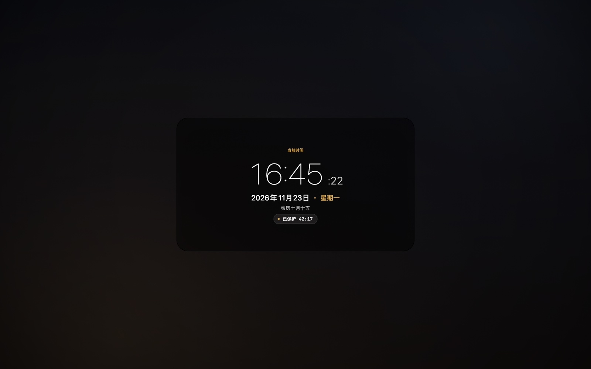
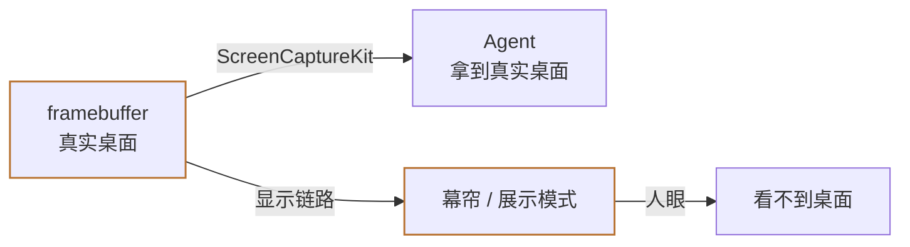
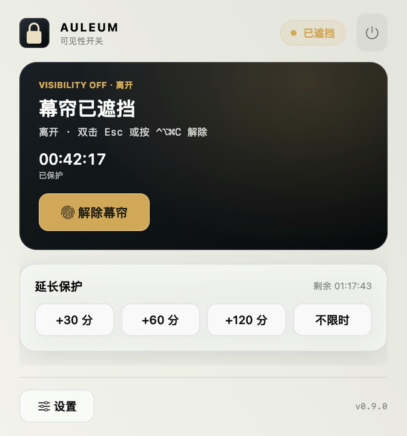
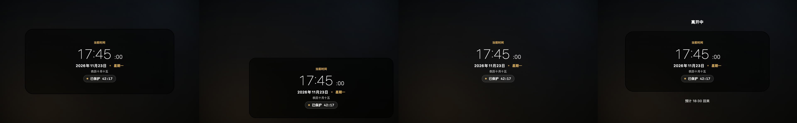
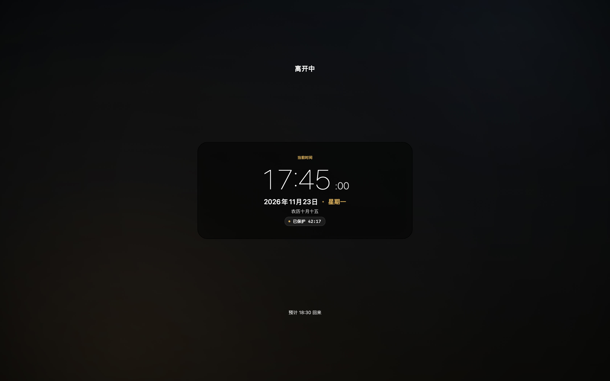
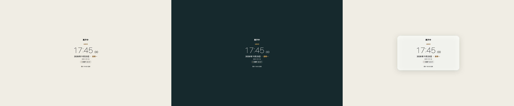
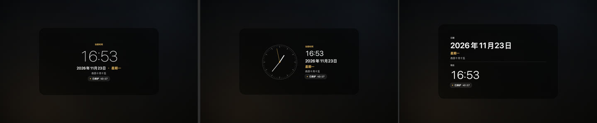

<p align="center">
  
</p>

<h1 align="center">Auleum（幕帘）</h1>

<p align="center">
  <strong>人看不到屏幕，Agent 的截图和录屏仍然拿到真实桌面。</strong>
</p>

<p align="center">
  <a href="https://github.com/NotoChen/Auleum/releases"></a>
  <a href="LICENSE"></a>
  
</p>

<p align="center">
  
  <br>
  <sub>展示模式 · 居中卡片 · 内置渐变背景</sub>
</p>

它用全屏幕帘盖住显示器，拦下物理键盘和鼠标，默认只留 Touch ID 作为正常出口（也可以显式开启密码兜底）。与此同时，拥有录屏权限的 Agent 通过 `auleumctl` 继续截图、录屏和合成输入。

适合离开工位、会议投屏或访客经过时：既挡住人的视线，又不打断正在运行的 Agent。

> [!IMPORTANT]
> 这不是锁屏。系统锁屏会把会话切到 loginwindow，第三方采集直接失效；幕帘是解锁状态下的遮挡层，所以 Agent 才能继续工作。

## 两种遮挡方式

| 方式 | 人看到 | Agent 采集 | 说明 |
|---|---|---|---|
| **展示模式**（默认） | 背景、时钟和场景提示 | 常规 ScreenCaptureKit 截图/录屏中不含展示窗口 | HDMI、采集卡会看到窗口内容 |
| **输出层幕帘** | gamma 写入的纯色 | framebuffer 不变，任意采集读到真实桌面 | 不能显示文字或图片 |



每块屏可以独立选择 `presentation` 或 `black`。关闭展示模式后，所有屏幕都使用输出层幕帘。

## 主要能力

- **物理输入拦截**：按事件来源区分物理、远控和合成输入；物理键鼠、滚轮、触控板和系统手势被吞掉，Agent 的合成点击和键盘正常送达。
- **远程控制兼容**：默认开启。识别 UU 远程、向日葵、AnyDesk、RustDesk、ToDesk、TeamViewer、屏幕共享等进程；幕帘期间放行远控键鼠、显示鼠标指针、放行系统手势，并允许远控端用双击 Esc 或撤幕快捷键发起验证，本机物理键鼠仍然拦截。真实幕帘的展示窗口始终忽略指针事件，远控和 Agent 的合成点击会落到下层应用；远控模式下切幕后 Auleum 主动让出应用焦点，键盘输入留给前台应用。可自动识别，也可用状态面板或 `auleumctl remote on|off|auto` 手动切换。远控输入发起的撤幕在开启密码兜底后使用系统密码面板，未开启兜底时保持幕帘并提示，因为 Touch ID 需要本地手指；本机物理输入仍优先 Touch ID。
- **默认 Touch ID 出口**：双击 <kbd>Esc</kbd>、长按 <kbd>Esc</kbd>、全局快捷键、`auleumctl off` 都进入同一个验证流程；验证界面是幕帘内的自定义 Touch ID 卡片（指纹比对仍由系统完成），不会弹系统认证面板；认证失败或取消时回到幕帘。密码兜底默认关闭，开启后 Touch ID 不可用、验证失败或锁定时改用系统密码面板，期间物理键鼠放行给面板，合成输入仍被拦截。Touch ID 不可用、权限撤销、tap 失效、覆盖失败或睡眠时都保持幕帘；锁屏时让系统登录界面可见、解锁后立即补涂，幕帘状态不撤销。`panic` 和结束进程是仅有的应急出口，不走认证。
- **展示模式**：居中卡片、右下角、极简、自由四种版式；自由版式可在设置预览里直接拖动时钟、提示和返回时间。组件底板可透明，文字颜色随幕布颜色自适应。数字、表盘、日历三种时钟；秒、农历、计时组件可单独关闭；支持自定义背景图、循环播放的静音背景视频、内置极光/暖焰动态光影、焦点、缩放、暗化和全屏试看。Agent 可用 `auleumctl message` 更新幕帘上的进度消息，单行最多 200 字，不撤幕就能让人看到当前进展。
- **场景**：离开、会议、访客、专注四套完整预设，可独立配置时长、背景、时钟、提示文字和屏幕角色。
- **自动化**：空闲自动起幕、每日定时保护、默认保护时长；所有自动路径只负责起幕或发起 Touch ID，不会自动解锁。
- **多屏与热插拔**：按 `CGDirectDisplayID` 定位屏幕，混合黑屏/展示角色切换时先遮后换。
- **控制面与审计**：本地 socket + `auleumctl`，截图/录屏记录真实调用方；审计日志带哈希链。
- **内置更新**：启动后和每 6 小时检查 GitHub Releases；发现新版本后下载 `Auleum-<version>.zip`，用 Release 里的 SHA-256 校验，再校验 Bundle ID、版本号和代码签名。自动安装在幕帘关闭且未录制时进行，安装后重启；也可以在设置或状态面板手动检查、下载和安装。

## 安装

| 项目 | 要求 |
|---|---|
| 系统 | macOS 14+ |
| 硬件 | 带 Touch ID 的 Mac 或键盘；没有 Touch ID 时需在设置中开启密码兜底 |
| 工具链 | Command Line Tools；不需要完整 Xcode |
| 权限 | 两项：设备控制和数据访问（旧版为辅助功能）、录屏与系统录音 |
| 运行 | 本地运行，不需要账号或云服务 |

```bash
./Scripts/make_app.sh          # 产物：build/Auleum.app
open build/Auleum.app
```

安装到 `/Applications`：

```bash
INSTALL=1 ./Scripts/make_app.sh
```

发布包见 [GitHub Releases](https://github.com/NotoChen/Auleum/releases)：每个版本提供 `Auleum-<version>.dmg`、`Auleum-<version>.zip` 和对应的 SHA-256 校验文件。应用内置更新检查，默认会自动下载并安装新版本；也可以在「设置 → 更新」里关闭自动检查或手动触发。

项目使用 ad-hoc 签名，没有 Apple Developer ID 公证；在解决签名与公证之前，`brew` 也无法绕过 Gatekeeper。首次打开若被 Gatekeeper 拦截，请右键 `Auleum.app` →「打开」，或执行：

```bash
xattr -dr com.apple.quarantine /Applications/Auleum.app
```

首次启动后，在「系统设置 → 隐私与安全性」授予两项权限：

1. **录屏与系统录音**：截图和录屏。
2. **设备控制和数据访问**：事件拦截。macOS 26/27 使用这个名称；更早版本在「辅助功能」中授权。

设置页和权限引导会显示可拖拽的 app 图标；两项权限都变绿后浮窗自动收起。

> [!WARNING]
> ad-hoc 代码身份会随构建变化。重装后需要在两个权限面板里取消再勾选一次，然后重启 Auleum。

## 使用

菜单栏图标左键打开状态面板；设置、场景和退出入口都在面板里。

<p align="center">
  <picture>
    <source media="(prefers-color-scheme: dark)" srcset="docs/assets/dashboard-dark.jpg">
    
  </picture>
  <br>
  <sub>状态面板 · 已遮挡</sub>
</p>

### 快捷操作

| 动作 | 方式 |
|---|---|
| 起幕 | <kbd>⌃⌥⌘C</kbd>、`auleumctl on` 或状态面板 |
| 更新幕帘消息 | `auleumctl message "正在跑测试"`，`--clear` 清除 |
| 带时长起幕 | `auleumctl protect --minutes 30` 或对应场景快捷键 |
| 撤幕 | 双击 <kbd>Esc</kbd>、再按 <kbd>⌃⌥⌘C</kbd>、或 `auleumctl off`，然后通过 Touch ID（开启密码兜底时可用系统密码） |
| 取消认证 | 认证框或密码面板显示期间再按一次 <kbd>Esc</kbd> |
| 应急撤幕 | `auleumctl panic` 或 `pkill -TERM auleumd` |

### 命令行

```bash
auleumctl on [--minutes N]          # 起幕
auleumctl protect --minutes 30      # 起幕并设置保护时长
auleumctl scene away --minutes 120  # 场景起幕：away / meeting / guest / focus
auleumctl message "正在跑测试"       # 更新幕帘上的动态进度消息（展示模式）
auleumctl message --clear           # 清除动态消息，回落到场景提示
auleumctl off                       # 请求解除（Touch ID / 密码兜底）
auleumctl panic                     # 应急强制撤幕，不验指纹
auleumctl status                    # JSON 状态
auleumctl doctor                    # 权限 / 屏 / gamma / tap / 快捷键 / Touch ID / 密码兜底 / 远程兼容 / 审计链
auleumctl remote on|off|auto        # 远程兼容：手动开 / 手动关 / 回到自动识别
auleumctl remote status             # 远程兼容状态、检测到的远控工具与输入计数

auleumctl capture --out shot.png [--all | --display-id 1 | --region x,y,w,h] [--cursor]
auleumctl record start --out rec.mp4 [--fps 30] [--bitrate 8000000]
auleumctl record stop

auleumctl audit 20                  # 最近 20 条审计
auleumctl audit --verify            # 校验哈希链
auleumctl install-agent             # 开机自启
auleumctl uninstall-agent
auleumctl agent-status
```

### URL

```text
auleum://on?minutes=30
auleum://protect?minutes=30
auleum://off
auleum://status
auleum://settings
```

`minutes` 会限制在 0–1440；`off` 仍走 Touch ID。URL 有意不支持 `panic`。

`capture` / `record` 会从 socket peer PID 和父进程链识别真实调用方，例如 `Codex`、`Claude`、`Terminal` 或 `python3`，并写入审计。`--client` / `AULEUM_CLIENT` 只是任务标签，不是身份认证。

> [!TIP]
> 不确定哪里没配好？运行 `auleumctl doctor`，它会逐项检查权限、屏幕、gamma、tap、快捷键、Touch ID 和审计链。

### 卡住了怎么办

1. `auleumctl panic`：走本地 socket 强制撤幕，不验指纹。
2. `pkill -TERM auleumd`：进程退出后 macOS 恢复 gamma，黑幕和输入限制一起消失。
3. 没有可用 Touch ID 且未开启密码兜底时不会允许起幕。若幕帘开启后 Touch ID 失效且已开启密码兜底，再次触发撤幕会改用系统密码面板；未开启兜底时快捷键、`auleumctl off` 和非输入来源只会记录 `biometrics_unavailable` 审计并保持幕帘，请使用 `panic` / 结束进程应急撤幕。远控输入同样受密码兜底开关限制，未开启时会保持幕帘并提示。
4. 输入 tap 失效或权限被撤销时，幕帘也会保持。画面仍然遮挡，但物理键鼠可能已经不被拦截；请修复权限，或用 `panic` / 结束进程应急撤幕。

## 场景与自动化

| 场景 | 快捷键 | 默认时长 | 默认遮挡 |
|---|:---:|---:|:---:|
| 离开 | <kbd>⌃⌥⌘1</kbd> | 120 分钟 | 展示模式 |
| 会议 | <kbd>⌃⌥⌘2</kbd> | 60 分钟 | gamma 黑幕 |
| 访客 | <kbd>⌃⌥⌘3</kbd> | 30 分钟 | 展示模式 |
| 专注 | <kbd>⌃⌥⌘4</kbd> | 90 分钟 | gamma 黑幕 |

场景只影响当前这次会话，不修改全局展示模式。每个场景可以覆盖保护时长、展示方式、背景图、时钟样式、提示文字、预计返回时间和主/副屏角色。

自动化支持空闲起幕、每日定时保护和默认保护时长。所有自动路径到点只发起验证（默认 Touch ID）；系统睡眠、权限失效或覆盖失败都不会自动撤幕，而是保持遮挡、记录降级并重试；锁屏时暂时让出登录界面，解锁后立即补涂。

## 展示模式

默认开启。没有自定义背景图时使用内置深色渐变；也可以选择本地图片，等比铺满并裁切。

背景按优先级从高到低选择：场景背景图（场景提供时）→ 循环视频 → 图片 → 内置动态光影 → 默认深色渐变 → 幕帘颜色。视频使用系统解码循环播放并始终静音，等比铺满窗口；读取失败时自动回退到下一层背景，不会撤幕。动态光影提供「极光」和「暖焰」两套缓慢漂移的渐变，不增加文件依赖。

### 版式

<p align="center">
  
  <br>
  <sub>居中卡片 · 右下角（自动紧凑时钟） · 极简（无底板） · 自由（提示、时钟、返回时间分别摆放）</sub>
</p>

选择「自由」后，预览里的时钟卡片、「提示文字」和「预计返回时间」可以直接拖动；位置按屏幕宽高归一化保存，各显示器保持一致。小预览是示意比例，点「全屏试看」可以看到实际屏幕上的位置。提示和返回时间只在场景实际提供内容时出现。

<p align="center">
  
  <br>
  <sub>自由排版 · 三个组件独立定位</sub>
</p>

### 幕布颜色与组件底板

组件底板可选「自动 / 玻璃 / 透明」。自动模式让纯色幕布上的文字直接落在幕布颜色上，并按幕布亮度切换黑/白文字和铜色强调；图片和内置渐变仍保留半透明底板。极简版式始终没有底板。

<p align="center">
  
  <br>
  <sub>浅色幕布 · 透明组件 / 深色幕布 · 透明组件 / 浅色幕布 · 玻璃底板</sub>
</p>

幕帘颜色只在关闭内置背景且没有背景图时生效；它没有透明度。gamma 输出层只能改显示颜色，展示窗口也必须不透明，否则桌面会直接露给人和未经排除的采集路径。

### 时钟

<p align="center">
  
  <br>
  <sub>数字 · 表盘 · 日历；年、月、日、星期和中文农历</sub>
</p>

- 组件：秒、农历、「已保护」计时徽标可以分别关闭。
- 背景：焦点 0–100%、1–2× 缩放、0–80% 额外暗化。
- 屏幕角色：主屏和副屏可分别选择展示或 gamma 黑幕。
- 全屏试看：用当前草稿覆盖所有屏幕，8 秒后自动结束，不进入幕帘状态。

展示窗口使用 `sharingType = .none`，常规 ScreenCaptureKit 截图和录屏看不到窗口；HDMI、采集卡和私有采集 API 不在保证范围内。需要更严格的采集透明性时，使用 gamma 黑幕。

Agent 可以在不撤幕的情况下更新幕帘上的动态消息：

```bash
auleumctl message "正在跑测试，预计 12:30 完成"
auleumctl message --clear
```

消息会折叠换行和多余空白，最多 200 字，只显示在展示模式里；输出层 gamma 幕帘无法承载文字，此时命令会成功但返回 `visible: no`。起幕和撤幕时会自动清除动态消息。

## 设置

菜单栏图标 → 状态面板 → 设置。设置窗口分七页：

| 页面 | 内容 |
|---|---|
| 幕帘 | Esc 手势、快捷键、幕帘颜色、鼠标指针、密码验证兜底、远程控制兼容、自动识别远控、开机自启、合盖继续运行 |
| 自动化 | 空闲起幕、每日定时、时段结束验证、默认保护时长 |
| 场景 | 四个场景的时长、展示方式、背景、时钟、提示和屏幕角色 |
| 展示模式 | 版式（含自由拖动和组件底板）、背景图片/视频/动态光影、时钟样式、组件、屏幕角色、全屏试看 |
| 更新 | 自动检查、自动下载安装、立即检查、版本与发布说明 |
| 权限 | 两项权限状态和系统设置入口 |
| 诊断 | 复制诊断信息、打开审计日志、打开配置文件 |

保存后立即生效。支持 <kbd>⌘S</kbd> 保存、<kbd>⌘1</kbd>–<kbd>⌘7</kbd> 切换页面、<kbd>Esc</kbd> 关闭；有未保存修改时会询问保存、不保存或取消。

## 更新

默认开启自动更新检查。Auleum 启动后 8 秒检查一次，此后每 6 小时检查 `github.com/NotoChen/Auleum/releases/latest`；发现新版本后自动下载 `Auleum-<version>.zip`，用 Release 提供的 SHA-256 校验，再校验 Bundle ID、版本号和代码签名。只有幕帘关闭且没有录制时才会安装，安装后自动重启。如果当时正在保护，更新会保持「已就绪」，等撤幕或结束录制后再安装。

手动入口有两个：

- 菜单栏状态面板底部的刷新按钮。
- 「设置 → 更新」里的「检查更新」和「下载并安装」。

自动检查可以在设置里关闭；关闭后仍然可以手动检查。更新包只从 GitHub Releases 下载，Auleum 不上传设备信息。ad-hoc 签名意味着每次更新后 macOS 可能重新要求确认两项隐私权限。

## 配置

配置文件：`~/Library/Application Support/Auleum/config.json`

> [!NOTE]
> 文件以 `0600` 权限写入；非法值会回退到安全默认值。手工编辑后重启 `auleumd` 或重新保存设置即可生效。

常用字段：

| 字段 | 默认值 | 说明 |
|---|:---:|---|
| `presentationModeEnabled` | `true` | 是否使用展示模式 |
| `presentationLayout` | `"centered"` | `centered` / `corner` / `minimal` / `custom` |
| `presentationCustomLayout` | 内置位置 | 自由版式下时钟、提示、返回时间的归一化中心点 |
| `presentationComponentBackground` | `"auto"` | 组件底板：`auto` / `glass` / `clear` |
| `presentationClockStyle` | `"digital"` | `digital` / `analog` / `editorial` |
| `presentationImagePath` | `""` | 自定义背景图路径 |
| `presentationVideoPath` | `""` | 循环播放的静音背景视频；设置后优先于背景图 |
| `presentationAmbientStyle` | `"off"` | 内置动态光影：`off` / `aurora` / `ember` |
| `veilColor` | `"#000000"` | gamma 幕帘颜色 |
| `allowPasswordFallback` | `false` | Touch ID 不可用或验证失败时允许系统密码验证 |
| `remoteCompatibilityEnabled` | `true` | 幕帘期间放行远控输入、显示指针并放行系统手势 |
| `remoteAutoDetectEnabled` | `true` | 检测到常见远控进程时自动进入远程兼容模式 |
| `automaticUpdateChecksEnabled` | `true` | 启动后和每 6 小时检查 GitHub Releases |
| `automaticUpdateInstallsEnabled` | `true` | 自动下载、校验并安装新版本 |
| `holdToAuthSeconds` | `2` | 长按 Esc 的认证阈值 |
| `defaultProtectionMinutes` | `0` | 默认保护时长，0 表示不限时 |

完整字段、取值范围和场景配置见 [docs/configuration.md](docs/configuration.md)。

## 边界

- **不是锁屏**：会话保持解锁，第三方采集才能继续工作；系统一旦锁屏，采集立即失效。
- **默认需要 Touch ID**：密码兜底默认关闭；开启后 Touch ID 不可用或验证失败时使用系统密码面板，密码始终由 macOS 处理，Auleum 不接触明文。没有可用验证方式时不会允许起幕；Apple Watch/Companion 还没有接入。
- **不是软件安全边界**：只区分用户，不隔离同一用户下的进程；同用户可以调用 `panic`、结束进程或自行申请 TCC。
- **gamma 改的是显示输出，不是 framebuffer**：本机截图、录屏和远程屏幕共享读取 framebuffer 时仍能看到真实桌面。这是 Agent 继续工作的前提，也意味着它不是远程隐私工具。
- **幕布不是半透明遮罩**：`veilColor` 没有 alpha；展示窗口必须不透明，透明会直接露出桌面，和「人看不到屏幕」的前提冲突。
- **gamma 幕帘不能显示文字、图片或视频**：需要时钟、提示或动态背景时使用展示模式。
- **背景视频只在展示模式播放，并且始终静音**：Auleum 不采集也不播放声音，视频仅作为动态幕帘；视频不可读时回退到图片、动态光影或内置渐变，不会撤幕。静止画面下的隐私保证与图片背景相同。
- **展示模式不是更强的幕帘**：窗口层级和输入拦截相同，但采集保证更弱；HDMI、采集卡会看到背景和时钟。
- **挡不住物理动作**：电源键、长按强关、USB 设备接入不在事件流里。合盖运行只申请防休眠断言，真实行为由 macOS 电源策略决定。
- **合成事件需要来源 PID**：来源 PID 为 0 且 HID stateID 为 1 的事件按物理输入处理；带来源 PID、非 HID state 或带软件 userData 标记的事件按合成/远控输入处理。Agent 应通过 `CGEventSource` 投递点击和键盘。
- **远程兼容不是安全边界**：进程名单和 HID 设备识别用于兼容，不用于防伪；同一用户下的程序可以改名或直接投递合成事件。无法取得设备身份的虚拟 HID 输入在远程模式下仍按物理输入拦截，若某个远控工具的键盘仍不可用，`doctor` 的 `remote_hid_spi` 和进程列表可用于排查。
- **手势按模式处理**：严格模式下合成触控板手势也会被拦截；远程兼容模式下系统手势放行，Agent 仍应使用点击、键盘和截图。
- **自动化不会自动解锁**：空闲、定时和倒计时只负责起幕或发起 Touch ID。
- **失败不会自动撤幕**：tap 失效或权限撤销时画面仍保持遮挡，但物理输入可能已经不被拦截；这是严格保持幕帘的代价，应急出口是 `panic` 或结束进程。
- **锁屏会暂时让出画面**：锁屏/切换用户时覆盖层会先移除，让系统登录界面可见；幕帘状态保持为开启，解锁后重建。这不是 `veil_off`，桌面不会在锁屏期间露出。
- **审计不是防篡改**：哈希链能发现中途修改、删除和损坏，不能防同一用户重写整份文件或截断末尾。

## 设计与可靠性

权限只授予 `auleumd` 一处；Agent 通过 `auleumctl` 连接本地 socket，自身不持有屏幕录制权限。输入拦截、gamma 补涂、展示窗口、采集 broker 和 Touch ID 都在同一个常驻进程内。

单实例、LaunchAgent、录制分片、审计哈希链、稳定屏幕身份、混合多屏先遮后换、gamma 精度、崩溃恢复、tap 失效 watchdog、主线程心跳和失败保持幕帘等设计见 [docs/architecture.md](docs/architecture.md)。

## 相关项目

- [Lockpaw](https://github.com/sorkila/lockpaw)：覆盖层、agent hook、Touch ID/密码 fallback 和分发更完整；但锁屏是可被采集到的 overlay。
- [acamarata/curtain](https://github.com/acamarata/curtain)：面向 Screen Sharing 的物理/远程输入分流，不解决本机 Agent 的截图透明性。
- [iwaller/curtain](https://github.com/iwaller/curtain)：同样使用 gamma 输出层和 Touch ID，验证记录扎实；有密码 fallback 和系统锁屏恢复。

详细对比见 [docs/architecture.md](docs/architecture.md#与相关项目)。

## 开发与测试

```bash
./Scripts/test.sh
```

只依赖 Command Line Tools；脚本会处理 Swift Testing 宏插件路径，用 Xcode 工具链时也可以直接 `swift test`。最近一次源码测试：**111 tests / 18 suites**。仓库不包含 CI；发布和产物校验走本地脚本。

测试机为 Apple M1、双屏、macOS 27.2；代码目标 macOS 14+，但 macOS 14/15 的 gamma、权限面板和 ScreenCaptureKit 行为仍需单独实测。历史验证记录见 [docs/verification.md](docs/verification.md)。

版本变化见 [CHANGELOG.md](CHANGELOG.md)，发布说明见 [RELEASE_NOTES.md](RELEASE_NOTES.md)。

## License

MIT。见 [LICENSE](LICENSE)。

---

<p align="center">
  <a href="docs/configuration.md">配置参考</a> ·
  <a href="docs/architecture.md">架构与可靠性</a> ·
  <a href="docs/verification.md">验证记录</a>
</p>
